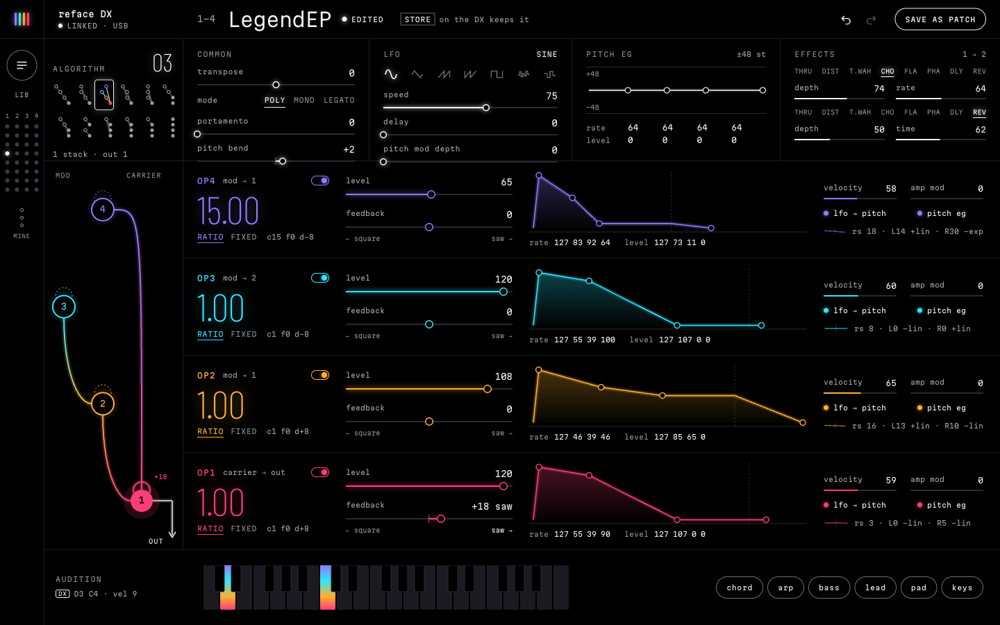

# reface DX editor

A real-time editor for the **Yamaha reface DX** FM synth. It has three parts:

- **Local server**: talks to the synth over USB-MIDI (SysEx).
- **Web panel**: shows every parameter of the current voice at once.
- **AI sound design**: describe a sound, and Claude programs the four operators.



## What it does

- **Two-way sync.** Every one of the 124 voice parameters is editable in the browser and stays in sync with the hardware: knob moves on the DX show up in the panel, and panel edits play on the DX.
- **Visual editing.** Algorithm graph, envelope editors, LFO and effects, with undo/redo.
- **Patch library.** Save and open patches as JSON files, and audition presets.
- **MIDI thru.** Play the DX from any other MIDI keyboard connected to your computer.
- **AI prompt bar** (optional, needs your own Anthropic API key). Type something like "glassy bell pad with a slow swell" and the server asks Claude for a complete voice.
- **CLI** (`node cli/dx.ts`) for scripting, or for driving the synth from Claude Code.

## Requirements

- A Yamaha reface DX connected over USB. It shows up as the MIDI port `reface DX`.
- Node.js **24 or newer**. The server runs TypeScript natively, with no build step.
- Developed and tested on macOS. MIDI goes through `@julusian/midi` (RtMidi), which also supports Windows and Linux, but those are untested.

The reface DX's USB port carries MIDI only, not audio. To hear it through your computer, connect the DX's OUTPUT jacks to your audio interface.

## Run it

```sh
git clone https://github.com/P3tr4-sway/reface-dx-web-editor.git
cd reface-dx-web-editor
npm install
npm run web:build
npm start
```

Then open http://localhost:7777.

The server also starts without the DX connected, and picks it up when you plug it in.

## Set your own API key (optional, for AI sound design)

The AI prompt bar uses the Claude API, billed to **your** Anthropic account. Without a key, everything else works.

1. Create a key at https://console.anthropic.com/.
2. Copy the example env file and add your key:
   ```sh
   cp .env.example .env
   # edit .env:  ANTHROPIC_API_KEY=sk-ant-...
   ```
3. Restart `npm start`. The startup line says `AI on`.

Only the local server reads `.env`; the key never reaches the browser. `.env` is gitignored, so never commit it.

## CLI

With the server running:

```sh
node cli/dx.ts status            # device, voice, dirty flag
node cli/dx.ts get               # all parameter values as JSON
node cli/dx.ts set op1.level=100 algorithm=5
node cli/dx.ts save my-patch     # data/patches/my-patch.json
node cli/dx.ts open my-patch
node cli/dx.ts thru "Your Keyboard"   # MIDI thru from another controller
node cli/dx.ts ai "warm electric piano"
```

`node cli/dx.ts params` lists every parameter and its range.

## Good to know

- **Edits only change the DX's edit buffer.** To keep a sound on the instrument, press STORE on the DX. Saving a patch in the editor writes a JSON file on your computer.
- **Loading a preset discards unsaved edits on the DX**, just as it does on the hardware.
- The editor never writes the DX's System settings (MIDI control, local control, auto power-off).

## Development

```sh
npm test             # unit tests (a fake DX, no hardware needed)
npm run typecheck
npm run web:dev      # UI hot reload on :5173, proxies to the server on :7777
```

The docs cover the details:

- [docs/architecture.md](docs/architecture.md): server, HTTP/WebSocket/CLI API, decisions.
- [docs/sysex-spec.md](docs/sysex-spec.md): the reface DX SysEx protocol, with a confidence tag on every fact, and measured operator curves.
- [design/README.md](design/README.md): UI spec.

## Disclaimer

This is an independent project, not affiliated with or endorsed by Yamaha. "Yamaha", "reface" and "DX7" are trademarks of Yamaha Corporation.
